# Arquitectura

Paquete `src/trading_ml`, instalado mediante `pyproject.toml`. La CLI y scripts orquestan módulos que también pueden invocarse desde Python. No hay servidor, interfaz gráfica ni ejecución de órdenes.

La nueva investigación principal vive en `trading_ml.dmn`, con entrada `python -m trading_ml.dmn` / `trading-dmn`. Se reutilizan el proveedor Binance, validación OHLCV, errores, procedencia, hashes, bloques bootstrap y protección de reservas. La política continua y el simulador de cartera tienen contratos propios: no se fuerzan dentro del clasificador probabilístico ni del simulador histórico de trades discretos. Instalación y fórmulas en [DMN_GUIDE.md](DMN_GUIDE.md), decisiones y desviaciones en [DMN_RESEARCH.md](DMN_RESEARCH.md), evidencia en [DMN_RESULTS.md](DMN_RESULTS.md).

```mermaid
flowchart LR
    R[OHLCV con checksum y cobertura] --> F[8 features causales y secuencias]
    F --> S[Train y validación interior purgados]
    S --> T[Lineal / MLP / LSTM / control XGBoost]
    T --> P[Checkpoint seleccionado sólo en validación]
    P --> O[Posiciones en siguiente fold exterior]
    O --> W[Riesgo ex ante y límite de exposición]
    W --> B[Holdings con deriva, costos y liquidación]
    B --> E[Curvas, folds, activos, semillas y bootstrap]
    E --> H[Artefactos inmutables y verificación contable]
```

Cada estudio DMN guarda plan anterior a los ajustes, código en ZIP, snapshots de datos, entorno, scalers de train, pesos seguros `state_dict`, historial de convergencia y registros de intentos. La reanudación verifica código/entorno/protocolo, reutiliza ajustes completados y conserva intentos incompletos. El verificador reconstruye cada cartera bruta/neta/con costos dobles desde pesos y retornos guardados. Los días excluidos por purga se conservan como cash en la curva de calendario. Estos resultados son desarrollo histórico; las reservas originales no se abrieron y no existe promoción automática de DMN.

## Módulos y responsabilidades

| Módulo | Responsabilidad |
| --- | --- |
| config | Dataclasses, lectura TOML, validación y contrato de indicadores/horizonte |
| data | Proveedor Binance mensual, retries, timeout, descarga concurrente limitada, caché y SHA-256 |
| preprocessing | Validación OHLCV, cobertura, fechas, duplicados, calendario cripto y dataset preparado |
| features | Retornos, ratios de rango/cuerpo/volumen, RSI, MACD, SMA y volatilidad causales |
| models | Registro de artefactos, integridad, carga nativa y selección explícita de features |
| training | Split temporal purgado, búsqueda en validación, entrenamiento y reentrenamiento desde cero |
| evaluation | Clasificación, calibración evaluada, baseline y comparación sobre una ventana común |
| prediction | Inferencia fuera del período utilizado y contrato de respuesta con advertencias |
| backtesting | Simulador independiente y servicio de predicciones fuera de muestra |
| common/errors | JSON estricto, hashes, versiones de entorno y errores de dominio |
| tests | Pruebas causales, errores de datos, costos, persistencia y recorridos completos |

## Contrato temporal

`timestamp` es el inicio UTC de una vela. `reference_time = timestamp + intervalo` es el momento en que todos sus OHLCV están disponibles. La predicción nunca usa velas todavía abiertas.

Para horizonte `h`, `target = 1` si `close[t+h] > close[t]`; en caso contrario es 0. `target_time` identifica cuándo se conoce la etiqueta. Las últimas h filas tienen etiquetas nulas; no se convierten artificialmente en bajadas. Las etiquetas y `future_return` nunca forman parte de las entradas de XGBoost.

El split aplica `train.target_time < validation.first_reference` y `validation.target_time < test.first_reference`. La purga es estricta: incluso una etiqueta conocida exactamente al inicio de la próxima ventana se elimina. La selección incluye información de validación, por lo que todo uso declarado fuera de muestra requiere `reference_time > selection_label_end`. Una comparación toma la intersección válida para todas las versiones.

Los indicadores usan exclusivamente ventanas retrospectivas y EWM no centrado. RSI usa suavizado exponencial alfa 1/window, inicializado por pandas; no garantiza igualdad bit a bit con plataformas que inicializan Wilder mediante SMA. MACD se normaliza por precio, SMA se expresa como distancia relativa, volatilidad usa desviación estándar de retornos (no anualizada). Las filas de calentamiento se eliminan como un prefijo; un NaN posterior produce error.

## Calidad de datos

Duplicados idénticos se eliminan y cuentan. Duplicados contradictorios, precios no positivos, volumen negativo, OHLC incoherente, timestamps desalineados, valores no finitos y huecos provocan errores explícitos. No se interpolan precios. La cobertura de los extremos se compara con start/end del manifiesto. Este calendario sólo es correcto para el mercado cripto continuo; acciones requieren otro calendario y manejo de ajustes corporativos.

Los archivos Binance se leen en memoria sin extraer rutas ZIP al disco. El adaptador interpreta timestamps ms/us, conserva URL/checksum de cada mes y verifica la caché. Una revisión de archivos del proveedor requiere `--refresh`; preservar snapshots previos permite reproducir resultados de una revisión anterior.

## Entrenamiento y artefactos

Semilla 42, CPU, `tree_method=hist`, `n_jobs=1`. Grilla de cuatro candidatos fijada antes del test. Se minimiza log-loss de validación y los empates retienen el primer candidato. No hay early stopping ni transformación ajustada con test. El modelo final conserva exactamente el entrenamiento en train del candidato seleccionado.

Cada versión nueva guarda configuración, receta completa, parámetros máximos y efectivos, particiones, hashes del código/datos/configuración y un snapshot propio del dataset preparado. UBJSON y metadatos se registran desde un directorio temporal por renombrado. `train` no evalúa test ni cambia punteros. `evaluate` produce evidencia separada y append-only cuando se solicita salida. `promote` verifica esa evidencia y reemplaza atómicamente `active.json`, el puntero autoritativo usado por los alias `latest`, `active` y `champion`. Los punteros y modelos históricos no se reescriben. Una operación fallida puede dejar un `.tmp_*` que no es una versión registrada. Detalles en [MODEL_LIFECYCLE.md](MODEL_LIFECYCLE.md).

`retrain` conserva el contrato y reconstruye la receta completa del padre, incluyendo búsqueda, límites máximos de árboles, ES interior, calibración disjunta, ventanas y semilla. Las recetas básicas vuelven a calcular sus fracciones cronológicas sobre el dataset ampliado; las temporales ajustan con etiquetas disponibles y reservan la evaluación posterior al nuevo cutoff, manteniendo la política y duración de las ventanas interiores. Las fronteras walk-forward históricas se conservan como procedencia, sin presentarlas como una nueva evaluación. Se exige historia compartida idéntica y nuevas referencias respecto del snapshot, independientemente de fechas de un test futuro pendiente. Los planes históricos se leen sin modificarlos. Toda etiqueta que invade una reserva prospectiva congelada queda bloqueada antes del ajuste. El candidato nunca se activa por reentrenarse.

La semilla y el lockfile permiten repetir el experimento en este entorno. No se promete igualdad numérica entre hardware, versiones o revisiones del proveedor. El test adversarial verifica que alterar OHLCV del test no cambia parámetros seleccionados, métricas de validación ni bytes del modelo.

## Backtest y límites

La señal al cierre de t habilita una compra en open[t+1], con slippage adverso y comisión. Se vende en open[t+h+1] con costos adversos también. No se solapan posiciones; una salida puede liberar capital para otra compra en esa apertura. El horizonte objetivo close/close no equivale al retorno de esa ejecución.

Se valúa la posición a precio de apertura en cada paso; la equity inicial se incluye al calcular drawdown. Buy and hold compra en la primera apertura elegible y vende en la última, con los mismos costos. Win rate cuenta operaciones con retorno neto positivo. Sin operaciones, win rate es nulo, no un 0% inventado.

El módulo independiente `simulate` recibe velas, señales, horizonte, costos y el límite temporal permitido. El servicio `backtest` carga/verifica el dataset, selecciona observaciones fuera de muestra y obtiene probabilidades del modelo. No utiliza `future_return` para ejecutar ni decidir posiciones. No hay short, margen ni acceso a APIs de órdenes.

## Extensión

Agregar proveedores detrás del contrato OHLCV/procedencia; indicadores cambiando la versión del esquema; modelos conservando la interfaz de probabilidades y metadatos; validación walk-forward manteniendo purga y evaluación aislada. El futuro backend puede importar la API Python o invocar la CLI JSON. Datos diarios incrementales, monitoreo de drift y confirmación prospectiva de calibración están pendientes. La calibración temporal aprendida se incorporó en la etapa SMC descrita abajo.

## Walk-forward y optimización moderada

`training/walk_forward.py` produce ventanas consecutivas exteriores con train expansivo o móvil y etiquetas purgadas. `fit_temporal_model` reserva una cola interior de train para early stopping de XGBoost, purga la separación interior y luego ajusta el modelo exterior con la cantidad de árboles seleccionada. El período externo no participa en esa selección. El mecanismo sigue la [API oficial de XGBoost](https://xgboost.readthedocs.io/en/stable/python/python_api.html); se registra la iteración efectiva y la frontera temporal interior.

`training/optimization.py` orquesta cinco recetas predefinidas como máximo (incluida la referencia), verifica el snapshot anterior, escribe un plan antes de entrenar y conserva resultados por fold. Las comparaciones utilizan las mismas referencias, etiquetas, estrategia, umbral y costos. E0 debe reentrenarse antes de cada fold: usar el modelo anterior guardado para fechas anteriores a su entrenamiento introduciría leakage. Son simulaciones retrospectivas de recetas fijas, no un historial real de despliegue.

`evaluation/selection.py` evalúa la regla de consistencia sólo sobre desarrollo: pérdidas probabilísticas, AUC, victorias entre ventanas, baseline constante y desempeño económico. La regla se fija en `config/optimization.toml`. Tras tres variantes consecutivas sin aceptación se detiene la búsqueda. La receta elegida se congela en `selection.json` antes de consultar el final.

Se reentrena una sola receta para comparar con el modelo anterior sobre el final. La aceptación de desarrollo y los checks finales se registran como elegibilidad; el optimizador conserva siempre los punteros activos. La promoción es una acción explícita separada que requiere evaluación registrada. Una ronda ya completada del mismo modelo/protocolo se recupera sin nuevos entrenamientos y sin modificar sus resultados históricos.

El dataset preparado es causal; las etiquetas futuras quedan separadas. En los backtests de desarrollo se excluyen **todas** las velas con referencia >= el límite exterior, además de purgar etiquetas: ni el precio de salida de un fold posterior entra en la selección. La exclusión adicional de señales sin salida se informa. Esto está probado alterando precios, features y etiquetas del período final y comprobando igualdad de todos los reportes walk-forward.

`Features.enhanced` permite 22 variables con esquema 2. Incluye momentum más largo, retornos rezagados, ratios de riesgo, ATR relativo, ubicación del cierre y variación logarítmica de volumen. `enhanced=false` se omite del contrato serializado para mantener exactamente los contratos de esquema 1 anteriores. No hay normalización ajustada globalmente ni selección de features usando test.

Los artefactos viven en `artifacts/optimization/<run_id>`: plan, datasets/manifiestos, resultados de desarrollo, selección, modelos por fold, predicciones OOF, equity/trades y comparación final. La documentación distingue el test final histórico ya observado de una evaluación prospectiva nueva, pendiente. Walk-forward de selección es desarrollo; sus métricas no se presentan como evidencia independiente de las decisiones realizadas allí.

## Módulo SMC y análisis probabilístico

`smc/detectors.py` contiene la máquina de estados de mercado, configuración validada y zonas acotadas en memoria. `smc/rules.py` contiene evidencia ponderada fijada y abstención. Las fórmulas completas, condiciones de mitigación y semántica temporal están en [SMC_RULES.md](SMC_RULES.md). Son definiciones operativas OHLCV, no mediciones de órdenes o instituciones.

Las confirmaciones de swings se emiten en la vela disponible y nunca se backdatean. FVG/OB guardan origen y momento de nacimiento por separado; sólo zonas existentes antes de t pueden producir retest en t. Las invalidaciones/expiraciones afectan el estado futuro, no las filas históricas. `detect_smc` devuelve 32 columnas numéricas más nombres y descripciones de zonas; `features/technical.py` las integra sólo con `Features.smc=true`.

Contrato 3: 14 features técnicas más 32 SMC (46 en esta ronda). Con SMC desactivado se omiten sus parámetros del contrato serializado, conservando exactamente esquemas 1 y 2. El loader verifica orden/schema/integridad y no entrega etiquetas futuras al modelo. Los datos mantienen calentamiento como prefijo y prohibición de huecos intermedios.

`training/smc_study.py` usa el splitter walk-forward existente, con original reentrenado por ventana, reglas sin ML y variantes combinadas. S2 conserva train/hiperparámetros originales para aislar el cambio de features. S3 usa dos colas temporales interiores: una para early stopping y otra posterior, purgada y disjunta, para calibración. El test histórico observado se excluye íntegramente de esta ronda; no se calculan sus métricas.

`models/calibration.py` ajusta una sigmoide regularizada sobre logit(p) y persiste coeficientes en JSON; no se usa pickle. La asociación entre calibrador y modelo no cambia tras el ajuste. Una pendiente negativa se colapsa a prevalencia en lugar de invertir el ranking; el estado queda registrado. La independencia entre clasificador y datos de calibración sigue el requisito de la [documentación oficial de scikit-learn](https://scikit-learn.org/stable/modules/calibration.html). La calibración aprendida se distingue de su validez empírica futura.

`ModelBundle.probabilities` aplica el calibrador sólo si existe en metadatos; los modelos previos conservan sus salidas. `models/registry.publish_candidate` guarda UBJSON/metadatos de investigación sin cambiar latest/champion; lo comparten optimización y estudio SMC. No hay promoción automática de SMC, incluso si una receta pasa los criterios.

`evaluation/signals.py` informa cantidad alcista/bajista/neutral, cobertura y acierto selectivo. Las probabilidades se evalúan en todas las filas; neutrales nunca cuentan como aciertos. La clasificación binaria convencional usa p>=0.5 y se documenta el empate de las reglas p=0.5; la abstención de la herramienta utiliza el intervalo 0.45/0.55. Neutral es un estado de evidencia, no una tercera clase de XGBoost.

`prediction/smc_analysis.py` devuelve activo, referencia, tendencia/estructura, patrones confirmados, zonas vigentes, probabilidades, estado neutral/direccional, horizonte, calibración, versión y advertencias. Puede informar tendencia estructural alcista y probabilidad neutral a una vela sin contradicción: responden a escalas y preguntas diferentes. Las reglas heurísticas se muestran separadas del modelo aprendido. No hay APIs de órdenes ni decisiones automáticas de compra/venta.

## Reserva prospectiva SMC

El plan congela una ventana nueva posterior al día UTC de ejecución. `prospective.json` mantiene estado pendiente; el candidato se ajusta/calibra sólo antes del test antiguo excluido, y se conserva el snapshot original para evitar revisiones retrospectivas del proveedor.

`evaluation/smc_prospective.py` sólo evalúa cuando todo el período, sus etiquetas y aperturas de salida están disponibles. Comprueba hash del plan, modelos/contratos y conservación exacta del histórico; exige todas las referencias reservadas. No refit, recalibración, selección ni promoción. Compara el original guardado, reglas fijas y candidato congelado: las fechas de ajuste de esas versiones pueden diferir; para atribución incremental se utiliza S2 con train igual en desarrollo.

El período final real está pendiente. Se verificó el rechazo de datos actuales incompletos y el recorrido completo con una emulación sintética aislada y reloj inyectado en tests, separada de los artefactos reales. Artefactos: `artifacts/smc_studies/<run_id>/{plan,selection,summary,prospective}.json`, snapshot, datasets y modelos/predicciones/equity/trades por fold. Repetir el mismo estudio recupera resultados sin consumir nuevas recetas.

## Mercado, proveedor y ejecución

`trading_ml.multimarket` añade instrumentos, proveedores H1 bid/ask FXCM/Dukascopy y artefactos independientes. Reutiliza features de precio, kernel de barreras, métricas, calibración, baselines, bootstrap y protección de reservas. La función de features original incorpora `include_volume` opcional, True por defecto; Forex lo pasa como False para no inventar volumen.

Las barras de señales y ejecución son distintas: Forex puede calcular features sobre H1/H4/D1 completo, pero toda entrada, stop, salida temporal y marca de equity recorre el H1 original. Excluir un bloque incompleto de features no elimina sus cotizaciones del backtest. `service.py` ofrece entrenamiento y carga por instrumento/intervalo, predicción sin labels y evaluación posterior al último resultado utilizado. No hay rutas de órdenes ni promoción al registro de producción. Detalles y contratos en [MULTIMARKET_RESEARCH.md](MULTIMARKET_RESEARCH.md).
